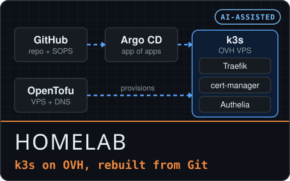

<b>Gamer · Modder · Software engineer</b> Grenoble 🇫🇷 · born in 1999

  
  
  
  

  
  
  
  
  
  
  
  
  

  
  
  
  

<b>Rainy Doom</b> · ▶️ <a href="https://youtu.be/G37yaG4MJuw">teaser</a> · <a href="https://github.com/McReaper/t7_workspace">t7_workspace</a>, 600+ commits 
<b>More BO3</b> · <a href="https://github.com/McReaper/t7_dxbc">T7 DXBC</a> 🤖 · <a href="https://github.com/McReaper/t7_radiant_bridge">T7 Radiant Bridge</a> 🤖 · 🎤 <a href="https://github.com/McReaper/building-a-rag-with-llms">REX talk</a> 🇫🇷 
<b>More Tarkov</b> · <a href="https://github.com/McReaper/SPT.NoScavSelect">No Scav Select</a> 🤖 (<a href="https://gitlab.com/vibrantrida/no-scav-select" title="Port of vibrantrida's mod">port</a>) · <a href="https://github.com/McReaper/SPT.NoInsurance">No Insurance</a> 🤖 (<a href="https://gitlab.com/vibrantrida/no-insurance" title="Port of vibrantrida's mod">port</a>) 
<b>Tooling</b> · <a href="https://github.com/VictorMalodPortfolio/DockerTooling">DockerTooling</a> 🤝 · <a href="https://github.com/McReaper/rumblestrip-go">Rumblestrip</a> 🤝 
<b>Fork patches</b> · <a href="https://github.com/McReaper/MTPlugins/tree/fix/menu-label-with-slash">MTPlugins</a> · <a href="https://github.com/McReaper/NevisX">NevisX</a> · <a href="https://github.com/McReaper/SPT-RaidReview/tree/mcreaper/reconnect">RaidReview</a> · <a href="https://github.com/McReaper/ManimalAmmoLoadingAnimations/tree/mcreaper/fixes">Ammo Anims</a> · <a href="https://github.com/McReaper/SPT.WeaponCamoAndStickers/tree/lazy-texture-previews">Weapon Camo</a>

🤝 AI-assisted: written with an AI agent (Claude Code), reviewed by me · 🤖 AI-built: written and tested by an AI agent, end to end

### :grey_question: About me

:sparkling_heart: Favorite Games

1. The Last of Us
2. The Last of Us Part II
3. Escape From Tarkov
4. DayZ
5. World Of Warcraft Classic
6. Dying Light
7. Dishonored
8. Skyrim
9. God Of War
10. God Of War Ragnarock
> And many more ... Like competitive games that I try to forget about, you know :wink:

:guitar: Music

- Instrumental Heavy Metal :metal:, I love very niche bands like:
  - Deaf Election
  - DeathKite
  - Sightless in Shadow
  - No Sons of Mine
  - Off Cuts
  - They Fall
  - Under Earth
  - For Giants
  - Andrew Hulshult
- US Rap (Logic and Eminem mostly)
- Synthwave (Danger, WaveShaper, ToneBox, DEADLIFE, Nightstop, Carpenter Brut ...)
- Drum N Bass (mostly for fun, thanks to Venjent)

:memo: Conference notes

- [AlpOSS 2026](https://github.com/McReaper/alposs2026_personnal_summary): my notes on the talks of this open-source conference in Échirolles

:mortar_board: School days

- [Panzer n' Parser](https://github.com/McReaper/PanzerNParser): a Java game built in four weeks by a team of seven at Polytech Grenoble
- [2021 internship](https://github.com/McReaper/InternshipINFO4) ([report](https://github.com/McReaper/InternshipINFO4Report)): evolving the PhaistOS DSL's compiler to generate Linux I/O scheduling kernel modules

:joy: Funny quotes

A few [quotes about our job](https://gist.github.com/McReaper/5ad72f2f6b572f7d6d19ceeea8ac32f1) that are sad but true.

On Discord, there is a low chance I accept your friend request if we don't share contacts or servers.

